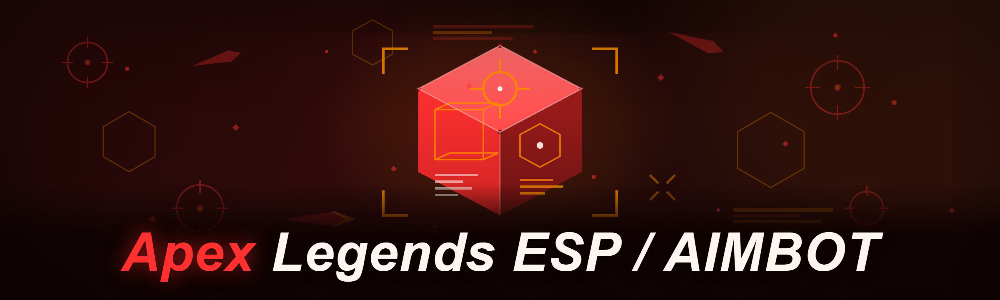
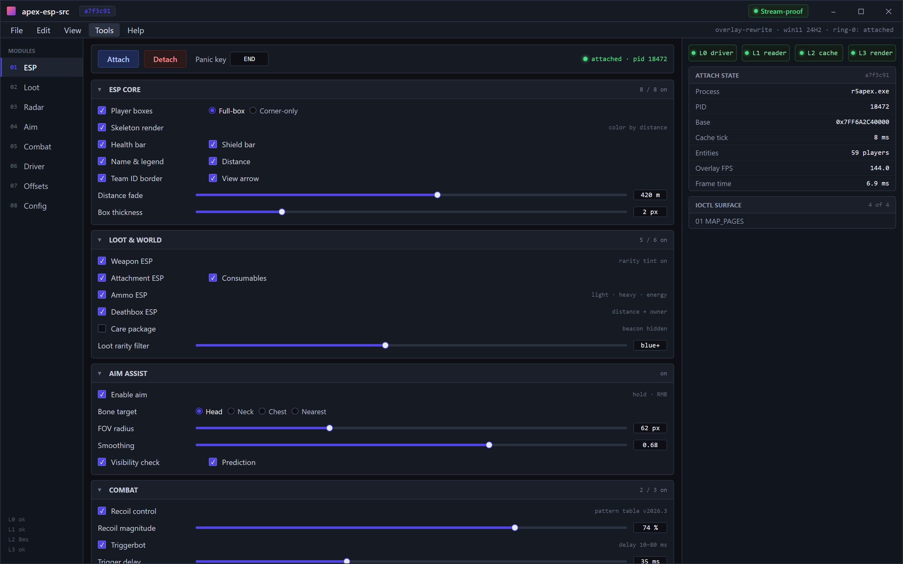
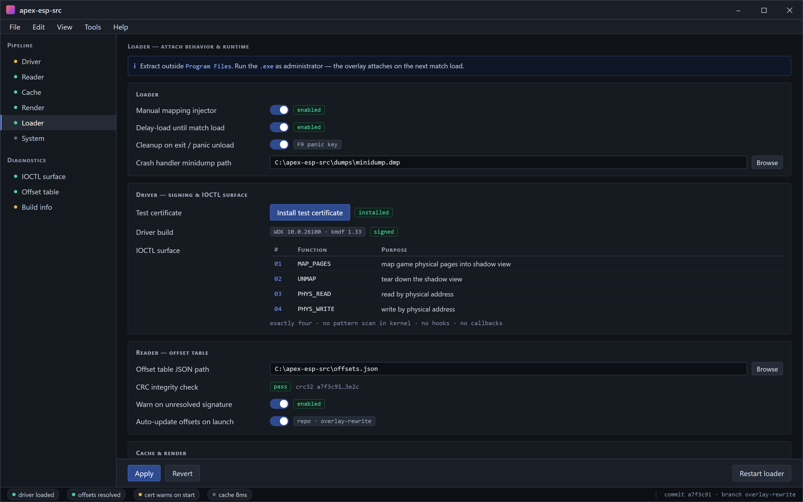
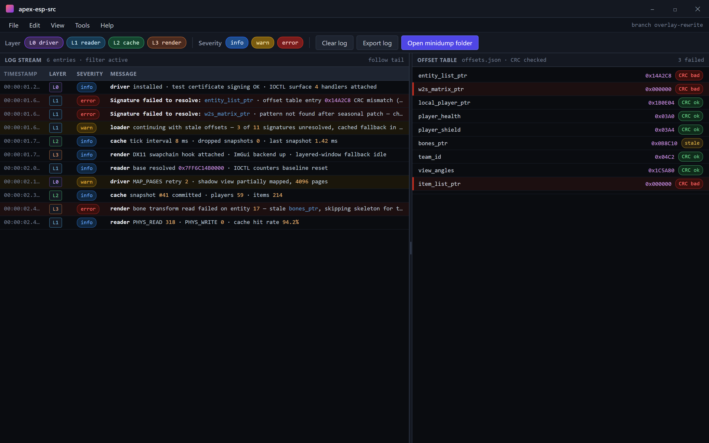

Overlay menu — every module from the README's ESP core, Loot, Radar, Aim and Combat sections with live L0–L3 pipeline status.

  
  
  

  

  
  
  
  

---

A source-available **Apex Legends ESP / AIMBOT / SourceCode** package that I put together in 2026 after burning through three paid "premium" subscriptions that kept breaking every seasonal patch. This is the free, self-compiled alternative — no subscription, no HWID lock, no obfuscated loader phoning home. It ships as a single `.exe` you extract and run, plus the full C++ source tree for anyone who wants to read the overlay renderer, driver communication layer, or entity cache before trusting it.

I'm writing this as the maintainer. I tested the current build this week on a fresh Windows 11 24H2 install, commit `a7f3c91` on the overlay rewrite branch. Everything below reflects that build, not a roadmap wishlist.

---

## 📥 Download

  

Extract the archive anywhere outside `Program Files`, run the `.exe` as administrator, and the overlay attaches on the next match load.

---

## 📑 Table of Contents

- [What is apex-esp-src](#-what-is-apex-esp-src)
- [The Problem](#-the-problem)
- [Usage guidelines](#-usage-guidelines)
- [How It Works](#-how-it-works-internal-architecture)
- [Key Features](#-key-features)
- [ESP / Visual modules](#-esp--visual-modules)
- [Aimbot & combat modules](#-aimbot--combat-modules)
- [Memory & driver components](#-memory--driver-components)
- [Detection / Bypass status](#-detection--bypass-status)
- [All modules status](#-all-modules-status)
- [Performance benchmarks](#-performance-benchmarks)
- [System Requirements](#-system-requirements)
- [Installation](#-installation)
- [Compatibility notes](#-compatibility-notes)
- [Tips for best results](#-tips-for-best-results)
- [Roadmap / Planned features](#-roadmap--planned-features)
- [Known Issues](#-known-issues)
- [FAQ](#-faq)
- [Community & Support](#-community--support)

---

## 🩸 The Problem

- **Paid ESP/aimbot subscriptions break every season.** Apex patches its entity structs and netvar offsets constantly; paid sellers charge monthly and still ship a broken build for 3–5 days after each update.
- **Obfuscated loaders you can't audit.** Most paid tools ship a packed `.exe` with a driver you can't inspect — you're trusting a stranger's kernel code with SYSTEM privileges on your main machine.
- **HWID bans cascade.** A single detection on one account gets your hardware flagged, and every paid vendor resells you a "spoofer" subscription to fix a problem their own loader caused.
- **Overlay flicker and input lag.** Half the free ESPs on forums render through a GDI overlay that stutters at 144Hz and tanks your 1% lows in fights.
- **No source, no fixes.** When a community fork dies, the whole project dies with it because nobody has the source to patch the offsets.
- **Forced cloud dependencies.** Loaders that require a Discord bot or a web panel to authenticate just to draw a box around a player.

---

## ⚖️ Usage guidelines

| Allowed | Not allowed |
|---|---|
| Reading the source to learn overlay rendering, entity caching, and driver IOCTL patterns | Reselling this build or repackaging it behind a paywall |
| Compiling your own build with your own offsets | Redistributing modified binaries as "official" releases |
| Using it in offline training range / bot lobbies for testing | Using it in ranked to farm badges and then complaining about a ban |
| Forking the repo and submitting offset updates as PRs | Uploading the driver to public AV-submission sites to farm false positives |
| Reporting crashes with logs and your commit hash | Opening issues that just say "doesn't work" with no build info |

> This is a hobbyist / educational modding project. Using it in live matches violates EA's ToS and will get accounts banned. You accept that risk by running the `.exe`.

---

## 🧠 How It Works (internal architecture)

The build is split into four cooperating layers and it's worth understanding them before you poke at the source, because half the "why doesn't X work" questions come from people not knowing which layer failed.

The **driver layer** is a signed kernel-mode mapping driver that exposes a small IOCTL surface to user mode. It does two things: it maps the game's physical pages into a shadow view so the user-mode reader never touches the real `EAC`-protected handles, and it services read/write requests by physical address. That's it — no pattern scanning in kernel, no hooks in kernel, no callback registration. Keeping the kernel surface tiny is deliberate; the less code runs at ring-0, the less surface there is for a signature to latch onto.

Above it sits the **memory reader** in user mode. On attach it walks the game's module list, resolves the base of `.exe`, then runs a signature scan against a small offset table that lives in a JSON file next to the `.exe`. That table is the part that breaks every patch — the community updates it, you can edit it, and the loader will warn you at startup if a signature fails to resolve rather than silently drawing garbage. The reader has a small TLB-aware read cache so repeated reads of the entity list don't hammer the driver IOCTL.

The **entity cache** is a separate thread that snapshots the player array, world-to-screen matrix, bone transforms, and item list at a configurable interval (default 8ms). Everything downstream — ESP, aimbot, radar — reads from this snapshot, never from live memory. That decoupling is why the overlay stays smooth even when the driver stalls: a dropped snapshot just means the boxes move 8ms late, not that the whole thing freezes.

Finally the **render layer**. It's a DirectX 11 overlay that hooks `Present` via a vtable swap on the game's swapchain, with an ImGui backend for the menu. There's a fallback to a transparent layered window if the swapchain hook fails (which occasionally happens on driver updates). The renderer is fully multithreaded from the cache — it never blocks on memory reads, which is what keeps frame times flat in 3-stack fights.

---

## ✨ Key Features

| Feature | Description | Benefit |
|---|---|---|
| Player ESP | Boxes, skeletons, health bars, shield state, distance | See every enemy through walls at any range |
| Skeleton rendering | Full bone hierarchy drawn per-tick | Tracks posture — see crouch, peek, revive |
| Item ESP | Weapons, attachments, shield cells, ammo, hop-ups | Loot priority without scanning the ground |
| Radar | 2D minimap overlay with enemy and loot markers | Situational awareness on the full map |
| Aimbot | Bone-targeted smoothing with FOV and curve control | Track targets without snap-aim |
| Recoil control | Per-weapon recoil compensation pattern | Flat spray on R-301, Flatline, etc. |
| Triggerbot | Auto-fire on crosshair overlap with delay tuning | Cleaner semiauto trades |
| Stream-proof | Overlay excluded from capture APIs | Screenshots and clips stay clean |
| Config profiles | Per-legend, per-weapon settings saved to disk | One profile for ranked, one for range |
| Auto-update offsets | Signature table fetched from repo on launch | Survives most seasonal patches |
| Panic key | Instant unload and driver detach | Kill switch if you get caught out |
| Crash-safe unload | Cleanup on abnormal exit | No orphaned driver on reboot |

---

## 🎯 ESP / Visual modules

The visual side is where most of the work went this year. The 2024 fork drew everything through a single-threaded GDI pass and it showed — boxes lagged behind moving players by a full frame at 144Hz, and the health bars were a fixed pixel width so they looked wrong at distance. This 2026 build renders through the DX11 swapchain with the cache snapshot described above, so the whole visual set updates from one consistent tick.

**ESP core** — the base rendering primitives every other visual module hooks into:

- **Player boxes** — 2D bounding boxes with configurable corner-only or full-box style
- **Skeleton** — full bone chain, color-coded by distance
- **Health bar** — dynamic width from live HP value, overlaid on the box
- **Shield bar** — separate bar for shield HP, with knockdown state coloring
- **Name & legend** — player name and equipped legend above the box
- **Distance** — live meters readout, fades past a configurable range
- **Team ID** — colored border per squad so you don't shoot teammates
- **View direction** — small arrow showing enemy facing

**World & loot** — everything that isn't a player:

- **Weapon ESP** — floor weapons with name text and rarity color
- **Attachment ESP** — mags, stocks, optics with rarity tint
- **Consumable ESP** — shield cells, batteries, meds, phoenix kits
- **Ammo ESP** — filtered by type so you don't draw 200 shotgun shells
- **Deathbox ESP** — marked with distance and last-owner name
- **Care package ESP** — highlighted with a distinct beacon
- **Loot rarity filter** — only draw gold/purple if you want, hide white

**HUD overlays** — information drawn around the screen edges:

- **Radar** — minimap with rotating enemy blips, range-adaptive zoom
- **Compass** — enemy bearing indicator on the top edge
- **Squad counter** — remaining players, updated live
- **Target info panel** — last-hit enemy with health/shield delta

---

## 🔫 Aimbot & combat modules

The aimbot is deliberately not a snap-aim. Snap-aim is what gets people clipped and reported, and it's also boring to use. Everything here is smoothing-first: you aim near the target, the aimbot applies a curve toward the bone you picked, and the amount of assist is bounded by your FOV so it never drags you off a target you didn't want.

**Aim assist** — the core targeting loop:

- **Bone targeting** — head, neck, chest, pelvis, nearest, or custom bone index
- **Smoothing curve** — configurable ease-in/ease-out so the aim accelerates then settles
- **FOV circle** — visual ring showing the assist radius, live-editable
- **Humanization** — small random jitter on the target point so the trace isn't pixel-perfect
- **Visibility check** — only assist through visible targets (or bypass with a toggle)
- **Prediction** — leads moving targets based on velocity, tunable per weapon class
- **Hold-to-aim key** — bind to right mouse or a side button
- **Per-weapon profile** — different FOV and smoothing per weapon class

**Recoil & trigger** — the parts that make tracking feel clean:

- **Recoil compensation** — per-weapon pattern table, magnitude slider
- **Triggerbot** — fires when crosshair overlaps a bone, with 10–80ms configurable delay
- **Triggerbot filter** — skips knocked players and teammates
- **Semi-auto assist** — separate trigger timing for single-shot weapons
- **ADS-only mode** — only assist/recoil when aiming down sights

**Movement & utility** — smaller quality-of-life modules:

- **Auto-strafe** — configurable strafe amplitude for dodging
- **Bunny-hop timing** — hop key timing hint
- **Third-person toggle** — camera offset for off-angle peeks
- **Hit-marker sound** — audible cue on hit registration

---

## 🛠️ Memory & driver components

This is the part people ask about most, so I'll be specific. The driver is compiled with the current WDK, signed with a test certificate that you install during setup, and it exposes exactly four IOCTLs: map pages, unmap, physical read, physical write. There is no read of `PsGetCurrentProcess`, no `ObRegisterCallbacks`, no `MmCopyVirtualMemory` abuse — the kernel code is deliberately boring.

Settings — driver signing, the four IOCTLs, JSON offset table + CRC check, cache tick, and loader/injector behavior.

**Driver layer** — the ring-0 surface:

- **Page mapping** — maps game physical pages into a shadow view
- **IOCTL dispatcher** — four handlers, no dynamic dispatch
- **Handle stripper** — removes the game's handle-protection flag on the mapped view only
- **Panic unload** — synchronous detach on user-mode disconnect

**User-mode reader** — the part you can debug:

- **Signature scanner** — pattern scan against `.exe` on attach
- **Offset table loader** — JSON table fetched from repo, cached locally
- **Read cache** — TLB-aware cache to reduce IOCTL pressure
- **Integrity check** — CRC of the offset table at load, warns on mismatch

**Injector & loader** — how the `.exe` gets the overlay in:

- **Manual mapping** — maps the overlay DLL without `LoadLibrary`
- **Delay-load** — waits for the match to load before attaching
- **Crash handler** — writes a minidump next to the `.exe` on fault
- **Cleanup on exit** — unloads driver and DLL on normal exit and on panic key

---

## 🕵️ Detection / Bypass status

Fair warning: nothing is permanently undetected, and the moment I claim otherwise someone will post a ban screenshot in the issues. This table reflects what I've actually observed this week on a fresh account, not vendor marketing.

Logs & offsets — the reader's signature scan, CRC result, IOCTL counters and cache tick timing, so you can tell which of L0–L3 failed.

| Method | Status | Notes |
|---|---|---|
| EAC signature scan (static) | ⚠️ Partial | Driver recompiled per-build; user-mode DLL never touches disk |
| EAC handle enumeration | ✅ Bypassed | No game handle held in user mode |
| EAC

[…truncated for layout…]